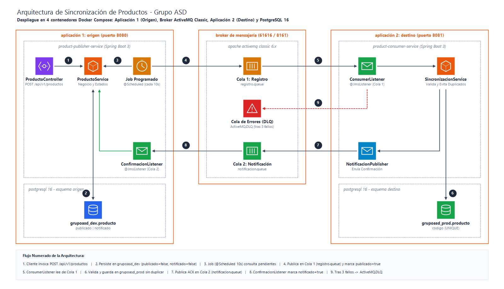
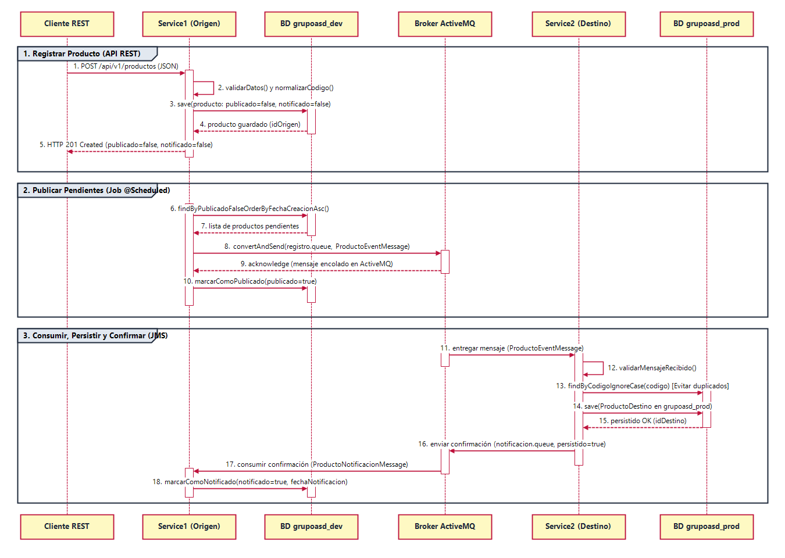
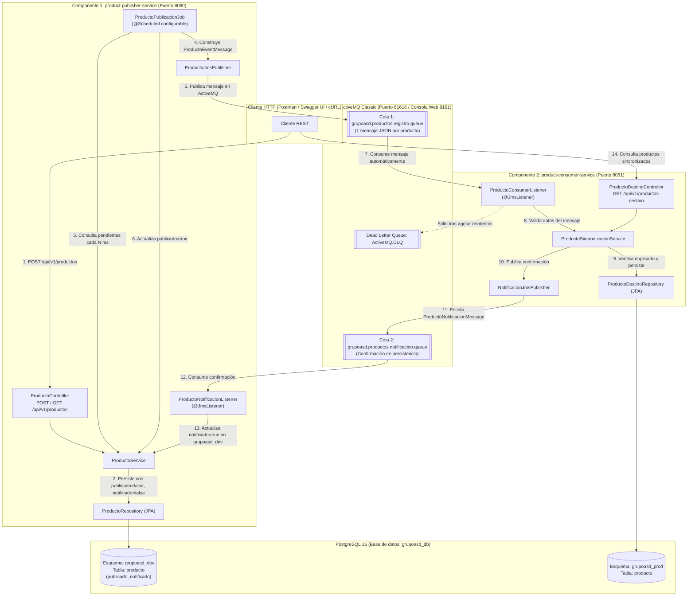

# Sistema de Sincronización Asíncrona de Productos — Grupo ASD

Solución de software compuesta por **dos aplicaciones independientes en Java 25 LTS y Spring Boot 3.5.16** que permite registrar productos en un esquema de origen (`grupoasd_dev`), identificarlos periódicamente mediante un Job programado (`@Scheduled`), publicarlos en **ActiveMQ**, consumirlos y persistirlos automáticamente en un esquema de destino (`grupoasd_prod`) y confirmar su recepción para actualizar el campo **`notificado = true`** en origen.

---

## Tabla de Contenido

1. [Contexto y Objetivo](#1-contexto-y-objetivo)
2. [Diagrama de Arquitectura y Flujo de Mensajes](#2-diagrama-de-arquitectura-y-flujo-de-mensajes)
3. [Alcance Funcional y Modelo de Datos](#3-alcance-funcional-y-modelo-de-datos)
4. [Mecanismo de Identificación de Pendientes, Prevención de Duplicados y Manejo de Errores](#4-mecanismo-de-identificación-de-pendientes-prevención-de-duplicados-y-manejo-de-errores)
5. [Requerimientos Técnicos, Clean Code y Estructura del Proyecto](#5-requerimientos-técnicos-clean-code-y-estructura-del-proyecto)
6. [Instrucciones de Instalación, Configuración y Ejecución](#6-instrucciones-de-instalación-configuración-y-ejecución)
7. [Pruebas Automatizadas y Evidencias](#7-pruebas-automatizadas-y-evidencias)
8. [Validación adicional de noviembre de 2026](#8-validación-adicional-de-noviembre-de-2026)

---

## 1. Contexto y Objetivo

La solución implementa dos microservicios desacoplados que se comunican de forma asíncrona a través de **Apache ActiveMQ Classic** y persisten datos en **PostgreSQL** utilizando **Spring Data JPA / Hibernate**:

- **Componente 1 (`product-publisher-service` — Puerto `8080`):** Expone la API REST para registrar y consultar productos en el esquema **`grupoasd_dev`**, ejecuta periódicamente el Job programado que identifica los productos pendientes (`publicado = false`), publica un mensaje JSON individual por cada producto en ActiveMQ y escucha la cola de confirmación para marcar **`notificado = true`**.
- **Componente 2 (`product-consumer-service` — Puerto `8081`):** Permanece suscrito a la cola de ActiveMQ, valida la estructura y los datos de cada mensaje recibido, persiste el producto en el esquema **`grupoasd_prod`** aplicando idempotencia y restricción de unicidad y envía la confirmación de persistencia hacia el Componente 1.

---

## 2. Diagrama de Arquitectura y Flujo de Mensajes

Los diagramas se entregan separados en **dos vistas independientes**, tanto en formato editable de **Draw.io** ([docs/diagrama-arquitectura.drawio](docs/diagrama-arquitectura.drawio) y [docs/diagrama-flujo-mensajes.drawio](docs/diagrama-flujo-mensajes.drawio)) como en imágenes PNG de alta resolución:

### 2.1. Diagrama 1: Arquitectura de Componentes e Infraestructura (Docker Compose)


### 2.2. Diagrama 2: Flujo de Mensajes y Estados de Sincronización (Pasos 1 al 10 + DLQ)


### 2.3. Vista en formato Mermaid



### Flujo esperado paso a paso (100% automático)
1. El cliente invoca `POST /api/v1/productos` en el Componente 1 (`8080`).
2. El servicio valida la información y persiste el producto en `grupoasd_dev.producto` con `publicado = false` y `notificado = false`.
3. El Job programado (`@Scheduled`) identifica el producto pendiente de publicación.
4. El Componente 1 publica en `grupoasd.productos.registro.queue` un mensaje JSON con toda la información del producto y actualiza `publicado = true`.
5. El Componente 2 (`8081`), suscrito a la cola, consume el mensaje automáticamente, valida sus atributos y verifica que el código no exista en `grupoasd_prod.producto`.
6. El Componente 2 persiste el producto en `grupoasd_prod.producto`; tras el commit de PostgreSQL, envía un mensaje de confirmación a `grupoasd.productos.notificacion.queue`. Si el procesamiento finaliza correctamente, la sesión JMS confirma la recepción del mensaje (`ACK`).
7. El Componente 1 recibe la confirmación y actualiza `notificado = true` y `fecha_notificacion` en `grupoasd_dev.producto`.

---

## 3. Alcance Funcional y Modelo de Datos

### 3.1. Modelo de Datos en Origen (`grupoasd_dev.producto`) y Destino (`grupoasd_prod.producto`)

| Campo | Tipo en Java / SQL | Esquema `grupoasd_dev.producto` | Esquema `grupoasd_prod.producto` | Descripción |
| :--- | :--- | :---: | :---: | :--- |
| `id` | `Long` / `BIGSERIAL PK` | Sí | Sí | Identificador único autogenerado. |
| `idOrigen` (`id_origen`) | `Long` / `BIGINT` | — | Sí | ID original del producto en `grupoasd_dev` para trazabilidad. |
| `codigo` | `String` / `VARCHAR(60) UNIQUE` | Sí | Sí | Código único del producto (normalizado en mayúsculas). |
| `nombre` | `String` / `VARCHAR(150)` | Sí | Sí | Nombre del producto. |
| `descripcion` | `String` / `VARCHAR(500)` | Sí | Sí | Descripción del producto. |
| `precio` | `BigDecimal` / `NUMERIC(19,2)` | Sí | Sí | Precio del producto (`> 0`). |
| `fechaCreacion` | `LocalDateTime` / `TIMESTAMP` | Sí | Sí | Fecha y hora de creación del registro. |
| `publicado` | `boolean` / `BOOLEAN` | Sí (`false` por defecto) | — | `true` cuando el Job publica el mensaje en ActiveMQ. |
| `notificado` | `boolean` / `BOOLEAN` | Sí (`false` por defecto) | — | `true` cuando el Componente 2 confirma persistencia en `grupoasd_prod`. |
| `fechaPublicacion` | `LocalDateTime` / `TIMESTAMP` | Sí | — | Fecha y hora en que fue publicado en ActiveMQ. |
| `fechaNotificacion` | `LocalDateTime` / `TIMESTAMP` | Sí | — | Fecha y hora de confirmación desde `grupoasd_prod`. |
| `intentosPublicacion` | `Integer` / `INTEGER` | Sí (`0` por defecto) | — | Número de intentos de publicación realizados por el Job. |
| `ultimoErrorPublicacion` | `String` / `VARCHAR(500)` | Sí | — | Detalle del último error si falló la publicación en ActiveMQ. |
| `fechaSincronizacion` | `LocalDateTime` / `TIMESTAMP` | — | Sí | Fecha y hora exacta de persistencia en `grupoasd_prod`. |

### 3.2. Endpoints REST Disponibles

#### Componente 1 (`product-publisher-service` — Puerto `8080`)
- `POST /api/v1/productos`: Registra un producto en `grupoasd_dev` (`201 Created`), o rechaza con `400 Bad Request` (datos inválidos) / `409 Conflict` (código duplicado).
- `GET /api/v1/productos`: Lista todos los productos registrados en `grupoasd_dev`.
- `GET /api/v1/productos/{codigo}`: Consulta un producto por su código único y muestra su estado `publicado` y `notificado`.
- `GET /api/v1/productos/pendientes-publicacion`: Lista los productos pendientes de publicación o de confirmación (`notificado = false`).
- `GET /api/v1/productos/logs-movimientos`: Consulta los logs de movimientos y errores del Componente 1 con fecha y hora.

#### Componente 2 (`product-consumer-service` — Puerto `8081`)
- `GET /api/v1/productos-destino`: Lista todos los productos consumidos desde ActiveMQ y persistidos en `grupoasd_prod`.
- `GET /api/v1/productos-destino/{codigo}`: Consulta un producto sincronizado en `grupoasd_prod` por su código.
- `GET /api/v1/productos-destino/logs-movimientos`: Consulta los logs de consumo, persistencia, duplicados omitidos y errores del Componente 2.

---

## 4. Mecanismo de Identificación de Pendientes, Prevención de Duplicados y Manejo de Errores

1. **Identificación de productos pendientes y confirmación de extremo a extremo:**
   - Todo producto registrado inicia con `publicado = false` y `notificado = false` en `grupoasd_dev.producto`.
   - El Job programado (`ProductoPublicacionJob`) consulta periódicamente los productos con `publicado = false` (ordenados por `fechaCreacion ASC`), publica un `ProductoEventMessage` en ActiveMQ por cada uno y actualiza `publicado = true` en una transacción independiente (`Propagation.REQUIRES_NEW`).
   - Una vez que el Componente 2 persiste el producto en `grupoasd_prod.producto`, envía un `ProductoNotificacionMessage` por la cola `grupoasd.productos.notificacion.queue` para que el Componente 1 marque `notificado = true`.
   - **Auto-recuperación (`reconciliarProductosSinConfirmacionEnDestino`):** Si un producto lleva más de 20 segundos con `publicado = true` y `notificado = false` (por ejemplo, tras una caída temporal del Componente 2), el Job lo reenvía automáticamente a ActiveMQ hasta que sea confirmado.
2. **Prevención de duplicados (Idempotencia):**
   - **En origen (`grupoasd_dev`):** Se valida `existsByCodigoIgnoreCase` en la capa de servicio (retornando `409 Conflict`) y se refuerza con la restricción `UNIQUE (codigo)` (`uk_producto_dev_codigo`) en PostgreSQL.
   - **En destino (`grupoasd_prod`):** Antes de insertar un producto consumido desde ActiveMQ, `ProductoSincronizacionServiceImpl` verifica `findByCodigoIgnoreCase`. Si el producto ya existe, omite el `INSERT` y reenvía la confirmación. Ante una colisión real por `UNIQUE (codigo)`, la operación fallida se revierte; el siguiente intento JMS reconoce el registro existente. No se consulta dentro de la transacción abortada.
3. **Manejo de errores, Reintentos y Dead Letter Queue (`ActiveMQ.DLQ`):**
   - **Fallos en publicación (Componente 1):** Si ActiveMQ no está disponible durante la ejecución del Job, se captura la excepción, se mantiene `publicado = false`, se incrementa `intentos_publicacion` y se guarda el motivo en `ultimo_error_publicacion` para reintentar en el próximo ciclo.
   - **Fallos en consumo o mensajes inválidos (Componente 2):** El listener JMS opera con sesión transaccional (`Session.SESSION_TRANSACTED`). Si un mensaje tiene datos inválidos o falla la base de datos, se lanza excepción haciendo rollback del ACK y activando la `RedeliveryPolicy` con backoff exponencial (`maximumRedeliveries = 3`, `initialRedeliveryDelay = 2000 ms`, `multiplier = 2.0`). Al agotar los reintentos, ActiveMQ mueve automáticamente el mensaje a la cola **`ActiveMQ.DLQ`**.

---

## 5. Requerimientos Técnicos, Clean Code y Estructura del Proyecto

### 5.1. Matriz de Versiones y Dependencias Compatibles

| Componente / Dependencia | Artefacto Maven / Imagen | Versión | Propósito en la Solución |
| :--- | :--- | :---: | :--- |
| **Java JDK** | `eclipse-temurin` | **`25 LTS` (`25.0.5`)** | Plataforma de ejecución y compilación de ambos microservicios. |
| **Spring Boot Parent** | `spring-boot-starter-parent` | **`3.5.16`** | Gestión centralizada de dependencias compatibles y autoconfiguración. |
| **Spring Web (API REST)** | `spring-boot-starter-web` | **`3.5.16`** (`Spring 6.2.19` / `Tomcat 10.1.55`) | Exposición de endpoints REST en el Componente 1 y consulta en Componente 2. |
| **Persistencia JPA / ORM** | `spring-boot-starter-data-jpa` | **`3.5.16`** (`Hibernate 6.6.53.Final`) | Persistencia y generación automática de los esquemas `grupoasd_dev` y `grupoasd_prod`. |
| **Validación de Datos** | `spring-boot-starter-validation` | **`3.5.16`** (`Hibernate Validator 8.0.3.Final`) | Validación declarativa (`@Valid`, `@NotBlank`, `@DecimalMin`) de DTOs y mensajes JMS. |
| **Mensajería Asíncrona JMS** | `spring-boot-starter-activemq` / `activemq-client` | **`6.3.2`** | Publicación, consumo asíncrono, `RedeliveryPolicy` y `ActiveMQ.DLQ`. |
| **Base de Datos Relacional** | `org.postgresql:postgresql` / `postgres:16-alpine` | **`42.7.14` / `16`** | Motor principal PostgreSQL con esquemas separados (`grupoasd_dev` y `grupoasd_prod`). |
| **Base de Datos Embebida** | `com.h2database:h2` | **`2.3.232`** | Ejecución en perfil `local` sin Docker y pruebas de integración automatizadas. |
| **Documentación OpenAPI** | `springdoc-openapi-starter-webmvc-ui` | **`2.8.17`** (`Swagger UI 5.32.2`) | Interfaz interactiva Swagger UI en los puertos `8080` y `8081`. |
| **Pruebas Automatizadas** | `spring-boot-starter-test` | **`3.5.16`** (`JUnit 5.12.2` / `Mockito 5.17.0`) | Suite de 14 pruebas de integración (`MockMvc`, `JUnit 5`, `AssertJ`, `Mockito`). |

- **Buenas prácticas aplicadas:** Separación estricta de capas (`controller`, `service`, `repository`, `messaging`, `scheduler`, `mapper`, `dto`, `domain`, `exception`, `config`), inyección por constructor, externalización total de configuración y credenciales mediante variables de entorno, DTOs desacoplados de las entidades JPA y manejo centralizado de excepciones (`@RestControllerAdvice`).

```text
grupoasd-product-sync/
├── docker/
│   ├── activemq/
│   │   └── Dockerfile                             # Imagen de ActiveMQ Classic con consola web habilitada
│   └── init-db/
│       └── 01-init-schemas.sql                    # Crea los esquemas grupoasd_dev y grupoasd_prod
├── docs/
│   ├── evidencias/                                # 14 capturas reales + diagrama PNG + RESULTADOS_PRUEBAS.md
│   ├── arquitectura.mmd                           # Diagrama de arquitectura y flujo de mensajes (Mermaid)
│   ├── explicacion_tecnica.md                     # Explicación técnica de mecanismos clave
│   ├── DOCUMENTACION_SOLUCION.md                  # Documentación detallada y evidencias de pruebas
│   └── GrupoASD-Product-Sync.postman_collection.json # Colección Postman lista para importar
├── product-publisher-service/                     # Componente 1 (Puerto 8080 - grupoasd_dev)
├── product-consumer-service/                      # Componente 2 (Puerto 8081 - grupoasd_prod)
├── .env.example                                   # Plantilla de variables de entorno
├── .gitignore
├── docker-compose.yml                             # Despliegue completo (PostgreSQL + ActiveMQ + 2 Apps)
├── DOCUMENTACION_SOLUCION.docx                    # Informe ejecutivo en Word con los 7 entregables oficiales
├── DOCUMENTACION_SOLUCION.pdf                     # Informe ejecutivo en PDF con los 7 entregables oficiales
├── pom.xml                                        # POM padre Maven multi-módulo
└── README.md
```

---

## 6. Instrucciones de Instalación, Configuración y Ejecución

### 6.1. Opción Recomendada: Ejecutar el Entorno Completo con Docker Compose
Levanta automáticamente PostgreSQL 16 (creando `grupoasd_dev` y `grupoasd_prod`), ActiveMQ Classic y ambos microservicios:

```bash
docker compose up --build -d
```

- **Swagger UI Componente 1 (`grupoasd_dev`):** [http://localhost:8080/swagger-ui/index.html](http://localhost:8080/swagger-ui/index.html)
- **Swagger UI Componente 2 (`grupoasd_prod`):** [http://localhost:8081/swagger-ui/index.html](http://localhost:8081/swagger-ui/index.html)
- **Consola Web ActiveMQ:** [http://localhost:8161/admin/queues.jsp](http://localhost:8161/admin/queues.jsp) (Usuario: `admin` / Contraseña: `admin`)
- **Conexión PostgreSQL en pgAdmin 4:**
  - **Host:** `localhost` | **Puerto:** `5432`
  - **Base de datos:** `grupoasd_db` | **Usuario:** `grupoasd_user` | **Contraseña:** `grupoasd_pass`
  - **Esquemas:** `grupoasd_dev` y `grupoasd_prod`

### 6.2. Cómo Modificar el Intervalo del Job sin Cambiar el Código Fuente
El intervalo del Job se configura mediante la propiedad `app.scheduler.publicacion.fixed-delay-ms` o la variable de entorno `JOB_CRON_INTERVAL_MS` (por defecto `10000` ms = 10 segundos):
- En `docker-compose.yml` o consola: `JOB_CRON_INTERVAL_MS=5000`
- En `product-publisher-service/src/main/resources/application.yml`: `fixed-delay-ms: ${JOB_CRON_INTERVAL_MS:10000}`

### 6.3. Opción Alternativa: Ejecución en Modo Local con Maven
```bash
# Terminal 1 - Componente 1 (Puerto 8080)
mvn -pl product-publisher-service spring-boot:run

# Terminal 2 - Componente 2 (Puerto 8081)
mvn -pl product-consumer-service spring-boot:run
```

---

## 7. Pruebas Automatizadas y Evidencias

### 7.1. Ejecutar la Suite de Pruebas Automatizadas (33 Tests: 15 Unitarias + 15 de Integración + 3 Flujo Completo E2E)
```bash
mvn clean verify
```
Las pruebas utilizan perfiles y recursos aislados: el perfil `test` configura H2 y un broker ActiveMQ embebido; algunas pruebas detectan una base PostgreSQL de pruebas disponible. Las dos pruebas adicionales de carrera requieren expresamente `grupoasd_test_db` por medio de `CONCURRENCY_TEST_DB_URL`, y se omiten en la ejecución habitual sin esa variable. No se deben confundir resultados históricos de octubre con los del 9 de noviembre.

#### A. Pruebas Unitarias Puras (`@ExtendWith(MockitoExtension.class)` — 15 Tests)
Evalúan la lógica de negocio, validaciones y transiciones de estado **en aislamiento total** con JUnit 5 y Mockito (`@Mock`, `@InjectMocks`), sin levantar contexto de Spring ni base de datos:

| # | Microservicio | Clase de Prueba | Método (`@Test`) | Qué Verifica |
| :-: | :--- | :--- | :--- | :--- |
| **1** | Componente 1 (`publisher`) | `ProductoServiceUnitTest` | `debeRegistrarProductoValidoConEstadoInicialPendiente` | Registro de producto válido con `publicado = false`, `notificado = false`, `intentosPublicacion = 0`. |
| **2** | Componente 1 (`publisher`) | `ProductoServiceUnitTest` | `debeNormalizarCodigoEnMayusculasYSinEspaciosExtremos` | Normalización de código (`trim` + `toUpperCase`) antes de validar unicidad y persistir. |
| **3** | Componente 1 (`publisher`) | `ProductoServiceUnitTest` | `debeRechazarCodigoDuplicadoSinGuardar` | Lanzamiento de `ProductoDuplicadoException` y garantía de que `save(...)` nunca se ejecuta (`never()`). |
| **4** | Componente 1 (`publisher`) | `ProductoServiceUnitTest` | `debeRechazarDatosInvalidosEnDtoDeSolicitud` | Rechazo de datos inválidos (código corto/vacío, nombre corto, descripción corta, precio negativo). |
| **5** | Componente 1 (`publisher`) | `ProductoServiceUnitTest` | `debeConstruirMensajeJmsCorrectamenteYMarcarPublicadoTrue` | Construcción del `ProductoEventMessage`, envío a `ProductoJmsPublisher` y cambio a `publicado = true`, `notificado = false`. |
| **6** | Componente 1 (`publisher`) | `ProductoServiceUnitTest` | `jobDebeIdentificarProductosPendientesYProcesarlosEnOrden` | Consulta ordenada `findByPublicadoFalseOrderByFechaCreacionAsc()` por el Job y publicación de cada pendiente. |
| **7** | Componente 1 (`publisher`) | `ProductoServiceUnitTest` | `debeMantenerProductoPendienteCuandoPublicacionEnActiveMqFalla` | Si ActiveMQ falla, conserva `publicado = false`, `notificado = false` e incrementa `intentosPublicacion = 1`. |
| **8** | Componente 1 (`publisher`) | `ProductoServiceUnitTest` | `debeActualizarNotificadoATrueAlProcesarConfirmacionValida` | Actualización de `notificado = true` y `fechaNotificacion` al recibir `ProductoNotificacionMessage(..., persistido = true)`. |
| **9** | Componente 1 (`publisher`) | `ProductoServiceUnitTest` | `debeIgnorarConfirmacionInvalidaOManejarConfirmacionRepetidaDeFormaIdempotente` | Ignora `persistido = false` y evita sobrescribir `fechaNotificacion` o invocar `save(...)` ante confirmaciones repetidas. |
| **10** | Componente 2 (`consumer`) | `ProductoSincronizacionServiceUnitTest` | `debePersistirProductoNuevoYEnviarConfirmacionCorrecta` | Persistencia de producto nuevo en `ProductoDestinoRepository` y envío de confirmación a la cola de retorno. |
| **11** | Componente 2 (`consumer`) | `ProductoSincronizacionServiceUnitTest` | `debeDetectarProductoExistenteYEvitarDuplicadosAnteMensajesRepetidos` | Idempotencia ante mensajes repetidos: omite `save(...)` pero reenvía confirmación al Componente 1. |
| **12** | Componente 2 (`consumer`) | `ProductoSincronizacionServiceUnitTest` | `debeEvitarDuplicadosAnteCondicionDeCarreraConcurrente` | Recuperación idempotente ante `DataIntegrityViolationException` concurrente sin duplicar registros. |
| **13** | Componente 2 (`consumer`) | `ProductoSincronizacionServiceUnitTest` | `debeConstruirConfirmacionConTodosLosDatosDeTrazabilidad` | Verificación exacta de `idOrigen`, `idDestino`, `codigo` y `persistido = true` en `ProductoNotificacionMessage`. |
| **14** | Componente 2 (`consumer`) | `ProductoSincronizacionServiceUnitTest` | `noDebeConfirmarProductoCuandoPersistenciaFallaYDebePropagarErrorParaReintento` | Si `save(...)` falla, propaga la excepción para activar el reintento JMS y nunca envía confirmación (`verifyNoInteractions`). |
| **15** | Componente 2 (`consumer`) | `ProductoSincronizacionServiceUnitTest` | `debeRechazarMensajesNulosOInvalidosYPropagarExcepcionParaDlq` | Rechazo de mensajes nulos o inválidos con `MensajeProductoInvalidoException` sin tocar BD ni confirmar. |

#### B. Pruebas de Integración Reales (`@SpringBootTest`, `MockMvc`, PostgreSQL 16 y ActiveMQ 6.3.2 — 15 Tests)
Verifican la integración real de controladores REST, repositorios JPA contra PostgreSQL (`grupoasd_test_db`), productores/listeners JMS contra ActiveMQ y `Awaitility`:

| # | Microservicio | Clase de Prueba | Método (`@Test`) | Escenario / Requerimiento Verificado |
| :-: | :--- | :--- | :--- | :--- |
| **16** | Componente 1 (`publisher`) | `ProductPublisherIntegrationTest` | `debeRegistrarProductoExitosamentePorApiRest` | `POST /api/v1/productos` válido (`201 Created`) y persistencia real en `grupoasd_dev.producto`. |
| **17** | Componente 1 (`publisher`) | `ProductPublisherIntegrationTest` | `debeRechazarProductoConCodigoDuplicado` | Rechazo de código duplicado con HTTP `409 Conflict`. |
| **18** | Componente 1 (`publisher`) | `ProductPublisherIntegrationTest` | `debeRechazarProductoConInformacionInvalida` | Rechazo de payload inválido con HTTP `400 Bad Request`. |
| **19** | Componente 1 (`publisher`) | `ProductPublisherIntegrationTest` | `debeConsultarProductoPorCodigoYListarTodos` | Consulta REST de productos guardados (`200 OK`) y manejo de `404 Not Found`. |
| **20** | Componente 1 (`publisher`) | `ProductPublisherIntegrationTest` | `jobDebeIdentificarPendientesYPublicarEnActiveMQ` | Identificación por el Job, envío real a la cola de ActiveMQ y cambio a `publicado = true` en PostgreSQL. |
| **21** | Componente 1 (`publisher`) | `ProductPublisherIntegrationTest` | `jobDebeGestionarFalloTemporalDePublicacionParaReintento` | Fallo temporal de publicación (`publicado = false`, `intentosPublicacion = 1`) y éxito en el siguiente ciclo. |
| **22** | Componente 1 (`publisher`) | `ProductPublisherIntegrationTest` | `debeActualizarNotificadoATrueCuandoComponente2ConfirmaPersistencia` | Consumo real por `@JmsListener` de la cola de confirmación y actualización de `notificado = true` en PostgreSQL. |
| **23** | Componente 1 (`publisher`) | `ProductPublisherIntegrationTest` | `debeReenviarProductosSinConfirmacionEnDestino` | Reenvío automático de productos con `publicado = true` y `notificado = false`. |
| **24** | Componente 1 (`publisher`) | `ProductPublisherIntegrationTest` | `debeRechazarConMensajeClaroCuandoPrecioContieneTexto` | Rechazo `400 Bad Request` ante JSON con texto en campo numérico `precio`. |
| **25** | Componente 2 (`consumer`) | `ProductConsumerIntegrationTest` | `debeConsumirPersistirYNotificarAlComponente1` | Recepción JMS real, validación, persistencia en `grupoasd_prod.producto` y publicación de confirmación en cola JMS. |
| **26** | Componente 2 (`consumer`) | `ProductConsumerIntegrationTest` | `debePrevenirDuplicadosAnteRecepcionRepetidaDeMensajes` | Recepción repetida del mismo producto por ActiveMQ sin duplicarlo en `grupoasd_prod.producto`. |
| **27** | Componente 2 (`consumer`) | `ProductConsumerIntegrationTest` | `debeFallarAnteMensajeInvalidoYEnrutarloADlqTrasReintentos` | Rechazo de mensaje inválido, reintentos JMS y envío final a `ActiveMQ.DLQ` sin persistir ni confirmar. |
| **28** | Componente 2 (`consumer`) | `ProductConsumerIntegrationTest` | `debeGestionarErrorDePersistenciaYRecuperarseEnReintentoJms` | Fallo temporal de BD en el primer intento JMS (sin confirmar) y persistencia exitosa en el reintento automático. |
| **29** | Componente 2 (`consumer`) | `ProductConsumerIntegrationTest` | `debeVerificarPoliticaDeReintentosAnteFallosReiterados` | Verificación de `RedeliveryPolicy` configurada en `ActiveMQConnectionFactory`. |
| **30** | Componente 2 (`consumer`) | `ProductConsumerIntegrationTest` | `debeGenerarEsquemaGrupoAsdProdYTablaProducto` | Verificación en `INFORMATION_SCHEMA` del esquema `grupoasd_prod` y tabla `producto`. |

#### C. Pruebas Automatizadas del Flujo Completo entre las Dos Aplicaciones (`FlujoCompletoSincronizacionE2ETest` — 3 Tests)
Ejecutan el ciclo completo extremo a extremo conectando `grupoasd_dev.producto` -> ActiveMQ (`registro.queue`) -> `grupoasd_prod.producto` -> ActiveMQ (`notificacion.queue`) -> `grupoasd_dev.producto`:

| # | Clase de Prueba | Método (`@Test`) | Escenario Extremo a Extremo Verificado |
| :-: | :--- | :--- | :--- |
| **31** | `FlujoCompletoSincronizacionE2ETest` | `debeEjecutarFlujoCompletoDeSincronizacionYConfirmacionEntreAmbasAplicaciones` | Verifica los 10 pasos del flujo completo: `POST /api/v1/productos` (`publicado=false, notificado=false`) -> Job publica en ActiveMQ (`publicado=true, notificado=false`) -> Consumidor persiste en `grupoasd_prod.producto` y publica confirmación -> Publicador recibe confirmación y actualiza `notificado=true` en `grupoasd_dev.producto`. |
| **32** | `FlujoCompletoSincronizacionE2ETest` | `noDebeDuplicarEnDestinoCuandoSeReenviaElMismoMensajeEnFlujoCompleto` | Verifica que ante el reenvío del mismo mensaje a través de ActiveMQ solo exista `1` fila en `grupoasd_prod.producto` y `notificado = true` en `grupoasd_dev.producto`. |
| **33** | `FlujoCompletoSincronizacionE2ETest` | `debeRecuperarseDeFalloTemporalDePublicacionYCompletarElFlujoEnElSiguienteCiclo` | Verifica que si el primer ciclo del Job falla (`publicado=false, intentos=1`, `0` filas en `grupoasd_prod`), el siguiente ciclo publica en ActiveMQ, persiste en `grupoasd_prod` y confirma `notificado=true` en `grupoasd_dev`. |

### 7.2. Documentación Técnica, Evidencias y Colección Postman
- **Resultados detallados de las 33 pruebas y validación Docker Compose:** [`docs/evidencias/RESULTADOS_PRUEBAS.md`](docs/evidencias/RESULTADOS_PRUEBAS.md)
- **Explicación técnica de mecanismos clave:** [`docs/explicacion_tecnica.md`](docs/explicacion_tecnica.md)
- **Diagrama de arquitectura en Mermaid y PNG:** [`docs/arquitectura.mmd`](docs/arquitectura.mmd) y [`docs/evidencias/diagrama-arquitectura.png`](docs/evidencias/diagrama-arquitectura.png)
- **Colección de Postman lista para importar:** [`docs/GrupoASD-Product-Sync.postman_collection.json`](docs/GrupoASD-Product-Sync.postman_collection.json)
- **Informe ejecutivo completo (7 entregables + 14 capturas de evidencia):** **`DOCUMENTACION_SOLUCION.docx`** y **`DOCUMENTACION_SOLUCION.pdf`**.

---

## 8. Validación adicional de noviembre de 2026

Se añadieron correcciones en la rama `fix/confirmaciones-y-consistencia-jms`, sin integrarlas todavía a `main`: comprobación cruzada de `codigo` e `idOrigen` en las confirmaciones, protección frente a confirmaciones negativas tardías, publicación de confirmación JMS después del commit de PostgreSQL, y rollback ante una colisión `UNIQUE`.

### 8.1. Evidencia de funcionamiento real (9 de noviembre de 2026)

- `docker compose build`: compilación de tres imágenes finalizada correctamente, tras corregir referencias de Dockerfiles.
- `docker compose ps`: cuatro contenedores activos; PostgreSQL y ActiveMQ reportados como `healthy`.
- API de origen, `GET /api/v1/productos/PROD-TEST-2026-002`: HTTP `200`, `id=4`, `publicado=true`, `notificado=true`, `intentosPublicacion=1`.
- API de destino, `GET /api/v1/productos-destino/PROD-TEST-2026-002`: HTTP `200`, `id=36`, `idOrigen=4`, mismo `codigo`, nombre y precio.
- Registro de código duplicado: HTTP `409 Conflict`, respuesta `Código de Producto Duplicado`.

### 8.2. Pruebas ejecutadas desde Docker y Maven

Para ejecutar la suite habitual desde Windows CMD, dentro del directorio raíz:

```cmd
docker run --rm -v "%cd%:/app" -w /app maven:3.10.0-eclipse-temurin-25-alpine mvn clean verify
```

Resultado comunicado el **9 de noviembre de 2026, 20:07:11 UTC**: `BUILD SUCCESS`; padre, publicador y consumidor con estado `SUCCESS`. El consumidor reportó `Tests run: 13, Failures: 0, Errors: 0, Skipped: 1`. La omisión corresponde a la prueba PostgreSQL especial al no suministrar su variable de entorno. El fragmento aportado no contiene el conteo exacto del publicador, por lo que no se atribuye una cifra total de pruebas a esa ejecución.

Para ejecutar la prueba específica de colisión concurrente contra PostgreSQL **de pruebas**:

```cmd
docker run --rm -e CONCURRENCY_TEST_DB_URL=jdbc:postgresql://host.docker.internal:5432/grupoasd_test_db?currentSchema=grupoasd_prod -v "%cd%:/app" -w /app maven:3.10.0-eclipse-temurin-25-alpine mvn -pl product-consumer-service -Dtest=ProductoConcurrencyPostgresTest test
```

**Resultado comunicado:** `Tests run: 1, Failures: 0, Errors: 0, Skipped: 0`, `BUILD SUCCESS`, 9 de noviembre de 2026 a las 20:02:36 UTC. Se forzaron dos inserciones concurrentes del código `PROD-CONCURRENT-REAL-01`: una persistió, la otra obtuvo `SQLSTATE 23505`; la operación repetida en una transacción nueva encontró el producto existente. Se verificó una sola fila.

Para ejecutar la prueba con **dos consumidores JMS concurrentes** y broker embebido de pruebas:

```cmd
docker run --rm -e CONCURRENCY_TEST_DB_URL=jdbc:postgresql://host.docker.internal:5432/grupoasd_test_db?currentSchema=grupoasd_prod -v "%cd%:/app" -w /app maven:3.10.0-eclipse-temurin-25-alpine mvn -pl product-consumer-service -Dtest=ProductoConcurrentJmsPostgresTest test
```

**Resultado comunicado:** `BUILD SUCCESS`, 9 de noviembre de 2026 a las 20:20:15 UTC. La prueba define `app.messaging.listener.concurrency=2-2` y `queue-prefetch=1`, utiliza una cola aislada, verifica dos notificaciones de persistencia con el mismo `idDestino` y una fila en PostgreSQL. No se aportó la línea individual `Tests run` de esa última ejecución; conservarla como evidencia adicional sería conveniente.

**Aclaración:** el `BUILD SUCCESS` del test especial significa que se completaron sus aserciones, no que se hayan comprobado todos los escenarios de caída del proceso. Una interrupción definitiva entre el commit en PostgreSQL y el envío de la notificación JMS **no** queda garantizada únicamente por `afterCommit()`; para protección fuerte se necesitaría un outbox transaccional o reconciliación persistente de confirmaciones.

### 8.3. Evidencias y entrega

- Evidencias y resultados anteriores (28 de octubre): [`docs/evidencias/RESULTADOS_PRUEBAS.md`](docs/evidencias/RESULTADOS_PRUEBAS.md).
- Nuevos resultados y observaciones (9 de noviembre): [`docs/evidencias/VALIDACION_2026-11-09.md`](docs/evidencias/VALIDACION_2026-11-09.md).
- Explicación técnica actualizada: [`docs/explicacion_tecnica.md`](docs/explicacion_tecnica.md).
- Los informes en PDF y Word existentes reflejan una versión anterior y requieren actualización antes de presentarlos como documentación de las correcciones de noviembre.
- **Revisión en equipo:** [Pull Request #1](https://github.com/mveranor1/grupoasd-product-sync/pull/1), todavía en borrador y sin fusionar a `main`.
