# Documentación Técnica de la Solución — Sincronización Asíncrona de Productos (Grupo ASD)

---

## 1. Contexto y Objetivo

### 1.1. Contexto
Se requiere una solución de software compuesta por dos aplicaciones independientes desarrolladas con **Java 25 LTS y Spring Boot 3.5.16**, utilizando **Spring Data JPA / Hibernate** para la persistencia en bases de datos relacionales y **Apache ActiveMQ Classic** como mecanismo de comunicación asíncrona desacoplada mediante mensajería JMS.

### 1.2. Objetivo
Implementar dos componentes desacoplados para:
1. Registrar productos en el sistema de origen (**`grupoasd_dev`**).
2. Detectar periódicamente los nuevos registros mediante un Job programado.
3. Publicar los productos en ActiveMQ (un mensaje individual por cada producto pendiente).
4. Consumir los mensajes en un segundo componente y persistirlos en el esquema de destino (**`grupoasd_prod`**) sin generar duplicados.
5. Confirmar la persistencia exitosa hacia el origen para actualizar el estado `notificado = true`.
6. Garantizar resiliencia ante caídas temporales de red, broker o base de datos, y canalizar mensajes no procesables hacia una cola de mensajes muertos (**`ActiveMQ.DLQ`**).

---

## 2. Diagrama de Arquitectura y Flujo de Mensajes

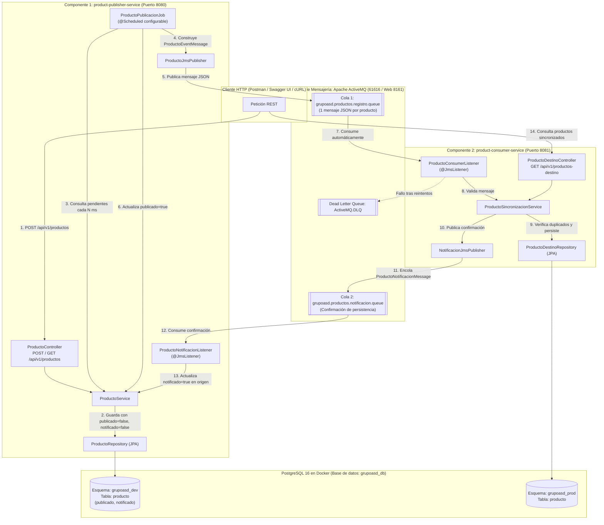

---

## 3. Alcance Funcional: Componente 1 (Publicador de Productos)

### 3.1. Servicio de Registro de Productos (API REST)
- Expuesto en el puerto **`8080`** bajo la ruta base `/api/v1/productos`.
- Valida que todos los campos requeridos estén presentes, formato de código alfanumérico, longitudes mínimas/máximas y precio estrictamente mayor a cero (`400 Bad Request`).
- Valida unicidad del código antes de persistir (`existsByCodigoIgnoreCase`) respondiendo HTTP **`409 Conflict`** si ya existe.
- Persiste en `grupoasd_dev.producto` con **`publicado = false`** y **`notificado = false`** por defecto.

### 3.2. Job de Identificación de Productos Nuevos
- Implementado en `ProductoPublicacionJob` anotado con `@Scheduled`.
- Consulta los productos con `publicado = false` en `grupoasd_dev.producto` ordenados por `fechaCreacion ASC`.
- Prepara un `ProductoEventMessage` (JSON) individual por cada producto con todos sus atributos (`idOrigen`, `codigo`, `nombre`, `descripcion`, `precio`, `fechaCreacion`, `fechaEnvioCola`).
- Publica el mensaje en `grupoasd.productos.registro.queue` y marca `publicado = true` en base de datos.
- Si falla la conexión con ActiveMQ, mantiene `publicado = false`, incrementa `intentos_publicacion` y guarda el mensaje de error en `ultimo_error_publicacion` para reintento automático.
- **Configuración externa**: El intervalo es configurable mediante `app.scheduler.publicacion.fixed-delay-ms` o la variable de entorno `JOB_CRON_INTERVAL_MS` sin tocar el código fuente.

### 3.3. Gestión del Esquema `grupoasd_dev`
- Gestionado con Hibernate (`default_schema: grupoasd_dev`).
- Contiene índices y restricciones únicas sobre la columna `codigo`.
- Registra bitácora completa de eventos en `logs/product-publisher-service.log` y vía `GET /api/v1/productos/logs-movimientos`.

---

## 4. Alcance Funcional: Componente 2 (Consumidor y Persistencia)

### 4.1. Consumo de Mensajes
- Implementado en `ProductoConsumerListener` anotado con `@JmsListener`.
- Permanece suscrito a la cola `grupoasd.productos.registro.queue`.
- Valida la estructura mediante Jakarta Bean Validation (`Validator`). Si los datos son inválidos, lanza excepción cancelando la transacción para que el mensaje no sea confirmado erróneamente.

### 4.2. Persistencia en el Esquema `grupoasd_prod` y Prevención de Duplicados
- Gestionado con Hibernate (`default_schema: grupoasd_prod`).
- Antes de insertar, verifica `findByCodigoIgnoreCase`:
  - **Si no existe**: lo persiste en `grupoasd_prod.producto` con `fechaSincronizacion = now()`.
  - **Si ya existe**: omite la inserción registrando `[RESULTADO: DUPLICADO OMITIDO]` garantizando idempotencia.
- En ambos casos, publica una confirmación (`ProductoNotificacionMessage`) a `grupoasd.productos.notificacion.queue` para que el Componente 1 actualice `notificado = true`.

### 4.3. Estrategia de Reintentos y Manejo de Errores (Dead Letter Queue)
- Sesión transaccional JMS (`Session.SESSION_TRANSACTED`).
- Si un mensaje es inválido o falla la persistencia, se activa la `RedeliveryPolicy`:
  - Reintentos máximos: 3 (`maximumRedeliveries`).
  - Retardo inicial: 2000 ms (`initialRedeliveryDelay`).
  - Backoff multiplicador: 2.0 (exponencial).
- Al agotar los reintentos, ActiveMQ mueve automáticamente el mensaje a la cola **`ActiveMQ.DLQ`** sin bloquear los mensajes válidos subsiguientes.

---

## 5. Modelo de Datos y Esquemas de Base de Datos

### 5.1. Esquema `grupoasd_dev.producto` (Origen)
| Columna | Tipo SQL | Restricción | Descripción |
| :--- | :--- | :--- | :--- |
| `id` | `BIGSERIAL` | `PRIMARY KEY` | Identificador autogenerado en origen |
| `codigo` | `VARCHAR(60)` | `NOT NULL UNIQUE` | Código único del producto |
| `nombre` | `VARCHAR(150)` | `NOT NULL` | Nombre del producto |
| `descripcion` | `VARCHAR(500)` | `NOT NULL` | Descripción del producto |
| `precio` | `NUMERIC(19,2)` | `NOT NULL` | Precio del producto |
| `fecha_creacion` | `TIMESTAMP` | `NOT NULL` | Fecha de creación del registro |
| `publicado` | `BOOLEAN` | `NOT NULL (DEFAULT false)` | Indica si fue enviado a ActiveMQ |
| `notificado` | `BOOLEAN` | `NOT NULL (DEFAULT false)` | Indica si fue confirmado en destino |
| `fecha_publicacion` | `TIMESTAMP` | `NULL` | Fecha de publicación en ActiveMQ |
| `fecha_notificacion` | `TIMESTAMP` | `NULL` | Fecha de confirmación desde destino |
| `intentos_publicacion` | `INTEGER` | `NOT NULL (DEFAULT 0)` | Cantidad de intentos de envío |
| `ultimo_error_publicacion` | `VARCHAR(500)` | `NULL` | Causa del último fallo de publicación |

### 5.2. Esquema `grupoasd_prod.producto` (Destino)
| Columna | Tipo SQL | Restricción | Descripción |
| :--- | :--- | :--- | :--- |
| `id` | `BIGSERIAL` | `PRIMARY KEY` | Identificador autogenerado en destino |
| `id_origen` | `BIGINT` | `NULL` | ID original en `grupoasd_dev` para trazabilidad |
| `codigo` | `VARCHAR(60)` | `NOT NULL UNIQUE` | Código único del producto |
| `nombre` | `VARCHAR(150)` | `NOT NULL` | Nombre del producto |
| `descripcion` | `VARCHAR(500)` | `NOT NULL` | Descripción del producto |
| `precio` | `NUMERIC(19,2)` | `NOT NULL` | Precio del producto |
| `fecha_creacion` | `TIMESTAMP` | `NOT NULL` | Fecha original de creación |
| `fecha_sincronizacion` | `TIMESTAMP` | `NOT NULL` | Fecha y hora de persistencia en `grupoasd_prod` |

---

## 6. Mecanismos de Control (Pendientes, Idempotencia y Resiliencia / DLQ)

1. **Control de Pendientes:**
   - La combinación `publicado = false` y `notificado = false` identifica con certeza los productos pendientes de salir.
   - El endpoint `GET /api/v1/productos/pendientes-publicacion` permite auditar en cualquier momento si existen productos en cola o sin confirmar.
2. **Auto-Recuperación ante Caídas de Red o Caídas del Consumidor:**
   - Si el Componente 2 está apagado o se cae la red, el producto se publica en ActiveMQ (`publicado = true`), pero queda con `notificado = false`.
   - El Job ejecuta `reconciliarProductosSinConfirmacionEnDestino()`: si un producto lleva más de 20 segundos con `notificado = false`, lo reenvía a ActiveMQ. Cuando el Componente 2 vuelve a estar en línea, procesa el mensaje y confirma `notificado = true`.
3. **Idempotencia:**
   - El consumidor verifica la existencia previa por código antes de insertar, evitando duplicados ante mensajes repetidos.
4. **Manejo de Errores y DLQ:**
   - Mensajes corruptos o con datos fuera de validación se rechazan sin ACK, pasan por la política de reintentos con backoff exponencial y se depositan en `ActiveMQ.DLQ`.

---

## 7. Requerimientos Técnicos, Clean Code y Estructura del Código

### 7.1. Matriz de Versiones y Dependencias Compatibles

| Componente / Dependencia | Artefacto Maven / Imagen | Versión | Propósito en la Solución |
| :--- | :--- | :---: | :--- |
| **Java JDK** | `eclipse-temurin` | **`25 LTS` (`25.0.5`)** | Plataforma de ejecución y compilación de ambos microservicios. |
| **Spring Boot Parent** | `spring-boot-starter-parent` | **`3.5.16`** | Gestión centralizada de dependencias compatibles y autoconfiguración. |
| **Spring Web (API REST)** | `spring-boot-starter-web` | **`3.5.16`** (`Spring 6.2.19` / `Tomcat 10.1.55`) | Exposición de endpoints REST en el Componente 1 y consulta en Componente 2. |
| **Persistencia JPA / ORM** | `spring-boot-starter-data-jpa` | **`3.5.16`** (`Hibernate 6.6.53.Final`) | Persistencia y generación automática de los esquemas `grupoasd_dev` y `grupoasd_prod`. |
| **Validación de Datos** | `spring-boot-starter-validation` | **`3.5.16`** (`Hibernate Validator 8.0.3.Final`) | Validación declarativa (`@Valid`, `@NotBlank`, `@DecimalMin`) de DTOs y mensajes JMS. |
| **Mensajería Asíncrona JMS** | `spring-boot-starter-activemq` / `activemq-client` | **`6.3.2`** | Publicación, consumo asíncrono, `RedeliveryPolicy` y `ActiveMQ.DLQ`. |
| **Base de Datos Relacional** | `org.postgresql:postgresql` / `postgres:16-alpine` | **`42.7.14` / `16`** | Motor principal PostgreSQL con esquemas separados (`grupoasd_dev` y `grupoasd_prod`). |
| **Base de Datos Embebida** | `com.h2database:h2` | **`2.3.232`** | Ejecución en perfil `local` sin Docker y pruebas de integración automatizadas. |
| **Documentación OpenAPI** | `springdoc-openapi-starter-webmvc-ui` | **`2.8.17`** (`Swagger UI 5.32.2`) | Interfaz interactiva Swagger UI en los puertos `8080` y `8081`. |
| **Pruebas Automatizadas** | `spring-boot-starter-test` | **`3.5.16`** (`JUnit 5.12.2` / `Mockito 5.17.0`) | Suite de 14 pruebas de integración (`MockMvc`, `JUnit 5`, `AssertJ`, `Mockito`). |

- **Clean Code & SOLID**:
  - Clases pequeñas y cohesivas con inyección por constructor (`final fields`).
  - Separación entre capas (`controller`, `service`, `repository`, `messaging`, `scheduler`, `mapper`, `exception`).
  - Eliminación de código duplicado mediante métodos auxiliares reutilizables.
  - Cero credenciales quemadas en código fuente (`application.yml` parametrizado con variables de entorno).

```text
grupoasd-product-sync/
├── docker/
│   ├── activemq/
│   │   └── Dockerfile                             # Imagen de ActiveMQ Classic con consola web habilitada
│   └── init-db/
│       └── 01-init-schemas.sql                    # Crea los esquemas grupoasd_dev y grupoasd_prod
├── docs/
│   ├── evidencias/                                # 14 capturas de prueba (Postman, pgAdmin 4, ActiveMQ)
│   ├── DOCUMENTACION_SOLUCION.md                  # Fuente técnica completa
│   └── GrupoASD-Product-Sync.postman_collection.json # Colección de pruebas de Postman
├── product-publisher-service/                     # Componente 1 (Puerto 8080 - grupoasd_dev)
├── product-consumer-service/                      # Componente 2 (Puerto 8081 - grupoasd_prod)
├── .env.example
├── .gitignore
├── docker-compose.yml                             # PostgreSQL + ActiveMQ + Microservicios
├── DOCUMENTACION_SOLUCION.pdf                     # Documento formal en PDF
├── pom.xml                                        # Maven Multi-Módulo Padre
└── README.md                                      # Guía de inicio rápido
```

---

## 8. Instrucciones de Instalación, Configuración y Ejecución

### 8.1. Despliegue con Docker Compose (Recomendado)
```bash
docker compose up --build -d
```
- **PostgreSQL 16**: `localhost:5432` | DB: `grupoasd_db` | User: `grupoasd_user` | Pass: `grupoasd_pass`
- **ActiveMQ Classic 6.3.2**: `tcp://localhost:61616` | Consola Web (solo local): [http://localhost:8161/admin](http://localhost:8161/admin) (`admin`/`admin`)
- **Componente 1 (API REST)**: [http://localhost:8080/swagger-ui/index.html](http://localhost:8080/swagger-ui/index.html)
- **Componente 2 (Destino)**: [http://localhost:8081/swagger-ui/index.html](http://localhost:8081/swagger-ui/index.html)

### 8.2. Modificación del Intervalo del Job sin Tocar el Código
- Mediante variable de entorno: `JOB_CRON_INTERVAL_MS=5000` (5 segundos).
- Mediante parámetro Maven en ejecución local:
  ```bash
  mvn -pl product-publisher-service spring-boot:run "-Dspring-boot.run.arguments=--app.scheduler.publicacion.fixed-delay-ms=5000"
  ```

---

## 9. Pruebas Automatizadas (Unitarias y de Integración) y Evidencias Visuales

### 9.1. Matriz de Cumplimiento de los 9 Escenarios Requeridos

| # | Escenario Requerido en la Prueba Técnica | Prueba Unitaria (`MockitoExtension`) | Prueba de Integración (`@SpringBootTest` / `MockMvc`) | Evidencia Visual (Postman / pgAdmin 4 / ActiveMQ) | Estado |
| :-: | :--- | :--- | :--- | :--- | :---: |
| **1** | **Registro exitoso de un producto mediante la API REST** | `ProductoServiceUnitTest` → `debeRegistrarProductoNormalizandoCodigoEnMayusculas` | `ProductPublisherIntegrationTest` → `debeRegistrarProductoExitosamentePorApiRest` | **Evidencia 1** y **Evidencia 11A** en Postman (`201 Created`, `publicado: false`, `notificado: false`) | ✅ PASS |
| **2** | **Rechazo de productos con información inválida o códigos duplicados** | `ProductoServiceUnitTest` → `debeLanzarExcepcionCuandoCodigoYaExiste` | `ProductPublisherIntegrationTest` → `debeRechazarProductoConCodigoDuplicado` y `debeRechazarProductoConInformacionInvalida` | **Evidencia 4 (`409 Conflict`)** y **Evidencia 5 (`400 Bad Request`)** en Postman | ✅ PASS |
| **3** | **Identificación de productos pendientes por parte del Job** | `ProductoServiceUnitTest` → `mapperDebeConstruirMensajeJmsCorrectamente` | `ProductPublisherIntegrationTest` → `jobDebeIdentificarPendientesYPublicarEnActiveMQ` | **Evidencia 2 (`GET /pendientes-publicacion`)** y **Evidencia 6 (Logs del Job)** | ✅ PASS |
| **4** | **Publicación correcta de los mensajes en ActiveMQ** | `ProductoServiceUnitTest` → `debeMarcarProductoComoNotificadoAlRecibirConfirmacion` | `ProductPublisherIntegrationTest` → `jobDebeIdentificarPendientesYPublicarEnActiveMQ` y `debeActualizarNotificadoATrueCuandoComponente2ConfirmaPersistencia` | **Evidencia 1 (`publicado: true, notificado: true`)** y **Evidencia 10 (Consola Web ActiveMQ)** | ✅ PASS |
| **5** | **Consumo y persistencia de productos en `grupoasd_prod`** | `ProductoSincronizacionServiceUnitTest` → `debePersistirProductoNuevoYEnviarConfirmacion` | `ProductConsumerIntegrationTest` → `debeConsumirPersistirYNotificarAlComponente1` | **Evidencia 3 (Postman Puerto 8081)**, **Evidencia 7 (Logs Comp 2)** y **Evidencia 9 (pgAdmin 4 `grupoasd_prod`)** | ✅ PASS |
| **6** | **Prevención de duplicados ante la recepción repetida de mensajes** | `ProductoSincronizacionServiceUnitTest` → `debeOmitirPersistenciaSiProductoYaExistePeroEnviarConfirmacion` | `ProductConsumerIntegrationTest` → `debePrevenirDuplicadosAnteRecepcionRepetidaDeMensajes` | **Evidencia 12 (ActiveMQ `Enqueued: 10, Dequeued: 10`)** e idempotencia en `ProductoSincronizacionServiceImpl` | ✅ PASS |
| **7** | **Recuperación ante fallos temporales de publicación o persistencia** | — (Integración de transacciones y JMS) | `ProductPublisherIntegrationTest` → `jobDebeGestionarFalloTemporalDePublicacionParaReintento` y `debeReenviarProductosSinConfirmacionEnDestino` | **Evidencia 11B (`PROD-002` con `publicado: true, notificado: false` durante caída temporal y posterior recuperación)** | ✅ PASS |
| **8** | **Manejo de mensajes inválidos y fallos reiterados (DLQ)** | — (Integración con bróker ActiveMQ) | `ProductConsumerIntegrationTest` → `debeFallarAnteMensajeInvalidoParaActivarReintentosYDlq` y `debeVerificarPoliticaDeReintentosAnteFallosReiterados` | **Evidencia 12 (Consola Web ActiveMQ mostrando mensaje inválido redirigido a `ActiveMQ.DLQ` tras agotar reintentos)** | ✅ PASS |
| **9** | **Generación de los esquemas y tablas requeridos (`grupoasd_dev` y `grupoasd_prod`)** | — (Integración JPA/Hibernate DDL) | `ProductPublisherIntegrationTest` → `debeGenerarEsquemaGrupoAsdDevYTablaProducto` y `ProductConsumerIntegrationTest` → `debeGenerarEsquemaGrupoAsdProdYTablaProducto` | **Evidencias 8A, 8B y 9 en pgAdmin 4** mostrando `grupoasd_dev.producto` y `grupoasd_prod.producto` | ✅ PASS |

### 9.1.1. Catálogo Detallado de las 20 Pruebas Automatizadas (`mvn clean test`)

#### A. Pruebas Unitarias Puras (`@ExtendWith(MockitoExtension.class)` — 6 Tests)
Evalúan la lógica de negocio y el mapeo de objetos **en aislamiento total** con JUnit 5 y Mockito (`@Mock`, `@InjectMocks`), sin levantar contexto de Spring ni base de datos:

| # | Microservicio | Clase de Prueba | Método (`@Test`) | Qué Verifica |
| :-: | :--- | :--- | :--- | :--- |
| **1** | Componente 1 (`publisher`) | `ProductoServiceUnitTest` | `debeRegistrarProductoNormalizandoCodigoEnMayusculas` | Normalización de código (`trim` + `toUpperCase`), inicialización de `publicado = false` / `notificado = false` e invocación a `repository.save(...)`. |
| **2** | Componente 1 (`publisher`) | `ProductoServiceUnitTest` | `debeLanzarExcepcionCuandoCodigoYaExiste` | Lanzamiento de `DuplicateProductCodeException` cuando el código ya existe y garantía de que `save(...)` nunca se ejecuta (`never()`). |
| **3** | Componente 1 (`publisher`) | `ProductoServiceUnitTest` | `debeMarcarProductoComoNotificadoAlRecibirConfirmacion` | Actualización de `notificado = true`, `publicado = true` y `fechaNotificacion` al procesar la confirmación del Componente 2. |
| **4** | Componente 1 (`publisher`) | `ProductoServiceUnitTest` | `mapperDebeConstruirMensajeJmsCorrectamente` | Conversión exacta en `ProductoMapper` desde la entidad `Producto` hacia `ProductoMensajeDTO` con `fechaEnvioCola`. |
| **5** | Componente 2 (`consumer`) | `ProductoSincronizacionServiceUnitTest` | `debePersistirProductoNuevoYEnviarConfirmacion` | Persistencia de producto nuevo en `ProductoDestinoRepository` y envío de ACK mediante `ProductoConfirmacionProducer`. |
| **6** | Componente 2 (`consumer`) | `ProductoSincronizacionServiceUnitTest` | `debeOmitirPersistenciaSiProductoYaExistePeroEnviarConfirmacion` | Idempotencia en aislamiento: si el código ya existe en destino, omite `save(...)` pero reenvía la confirmación al Componente 1. |

#### B. Pruebas de Integración (`@SpringBootTest`, `MockMvc`, H2 y ActiveMQ Embebido — 14 Tests)
Levantan el contexto completo de Spring Boot, controladores REST (`MockMvc`), validaciones Jakarta Bean Validation, JPA/Hibernate (creación real de esquemas `grupoasd_dev` y `grupoasd_prod`) y mensajería JMS:

| # | Microservicio | Clase de Prueba | Método (`@Test`) | Escenario / Requerimiento Verificado |
| :-: | :--- | :--- | :--- | :--- |
| **7** | Componente 1 (`publisher`) | `ProductPublisherIntegrationTest` | `debeRegistrarProductoExitosamentePorApiRest` | Registro exitoso mediante `POST /api/v1/productos` (`201 Created`, `publicado = false`, `notificado = false`). |
| **8** | Componente 1 (`publisher`) | `ProductPublisherIntegrationTest` | `debeRechazarProductoConCodigoDuplicado` | Rechazo de código duplicado con HTTP `409 Conflict`. |
| **9** | Componente 1 (`publisher`) | `ProductPublisherIntegrationTest` | `debeRechazarProductoConInformacionInvalida` | Rechazo de payload inválido (código vacío, precio negativo, etc.) con HTTP `400 Bad Request`. |
| **10** | Componente 1 (`publisher`) | `ProductPublisherIntegrationTest` | `debeConsultarProductoPorCodigoYListarTodos` | Consulta por código (`200 OK`), listado general y manejo de `404 Not Found`. |
| **11** | Componente 1 (`publisher`) | `ProductPublisherIntegrationTest` | `jobDebeIdentificarPendientesYPublicarEnActiveMQ` | Identificación de pendientes por el Job (`@Scheduled`), envío a ActiveMQ y actualización a `publicado = true`. |
| **12** | Componente 1 (`publisher`) | `ProductPublisherIntegrationTest` | `jobDebeGestionarFalloTemporalDePublicacionParaReintento` | Recuperación ante fallo temporal de ActiveMQ (`publicado = false`, registro en `ultimoErrorPublicacion` y reintento exitoso). |
| **13** | Componente 1 (`publisher`) | `ProductPublisherIntegrationTest` | `debeActualizarNotificadoATrueCuandoComponente2ConfirmaPersistencia` | Ciclo completo de confirmación asíncrona (`notificado = true` y `fechaNotificacion`). |
| **14** | Componente 1 (`publisher`) | `ProductPublisherIntegrationTest` | `debeReenviarProductosSinConfirmacionEnDestino` | Reenvío automático por el Job de productos con `publicado = true` y `notificado = false`. |
| **15** | Componente 1 (`publisher`) | `ProductPublisherIntegrationTest` | `debeGenerarEsquemaGrupoAsdDevYTablaProducto` | Verificación en `INFORMATION_SCHEMA` de la creación automática del esquema `grupoasd_dev` y tabla `producto`. |
| **16** | Componente 2 (`consumer`) | `ProductConsumerIntegrationTest` | `debeConsumirPersistirYNotificarAlComponente1` | Consumo JMS, persistencia en `grupoasd_prod.producto` y disparo de confirmación al Componente 1. |
| **17** | Componente 2 (`consumer`) | `ProductConsumerIntegrationTest` | `debePrevenirDuplicadosAnteRecepcionRepetidaDeMensajes` | Prevención de duplicados en `grupoasd_prod` ante recepción repetida del mismo mensaje JMS. |
| **18** | Componente 2 (`consumer`) | `ProductConsumerIntegrationTest` | `debeFallarAnteMensajeInvalidoParaActivarReintentosYDlq` | Rechazo de mensaje inválido sin confirmar (rollback JMS) para activar reintentos y DLQ. |
| **19** | Componente 2 (`consumer`) | `ProductConsumerIntegrationTest` | `debeVerificarPoliticaDeReintentosAnteFallosReiterados` | Verificación de `RedeliveryPolicy` (`maximumRedeliveries = 3`, backoff exponencial) hacia `ActiveMQ.DLQ`. |
| **20** | Componente 2 (`consumer`) | `ProductConsumerIntegrationTest` | `debeGenerarEsquemaGrupoAsdProdYTablaProducto` | Verificación en `INFORMATION_SCHEMA` de la creación automática del esquema `grupoasd_prod` y tabla `producto`. |

**Resultado de ejecución de la suite automatizada (`mvn clean test` — 6 Pruebas Unitarias + 14 Pruebas de Integración):**
```text
[INFO] Reactor Summary for Grupo ASD - Product Synchronization System 1.0.0:
[INFO] 
[INFO] Grupo ASD - Product Synchronization System ......... SUCCESS [  0.006 s]
[INFO] Product Publisher Service (Componente 1 - grupoasd_dev) SUCCESS [ 18.887 s]
[INFO] Product Consumer Service (Componente 2 - grupoasd_prod) SUCCESS [ 20.692 s]
[INFO] ------------------------------------------------------------------------
[INFO] BUILD SUCCESS (20 tests run: 6 unit tests + 14 integration tests, 0 failures, 0 errors)
[INFO] ------------------------------------------------------------------------
```

---

### 9.2. Evidencias Visuales de Pruebas Realizadas en Vivo

#### Evidencia 1 (Postman): Producto registrado en `grupoasd_dev` y confirmado automáticamente (`publicado: true` y `notificado: true`)
Tras registrar el producto `PROD-001` (*Laptop Corporativa Dell*) por `POST /api/v1/productos`, el Job programado lo publicó en ActiveMQ (`publicado: true`) y, una vez almacenado en el Componente 2, este notificó de vuelta al Componente 1 cambiando **`notificado: true`** (`GET http://localhost:8080/api/v1/productos/PROD-001`):

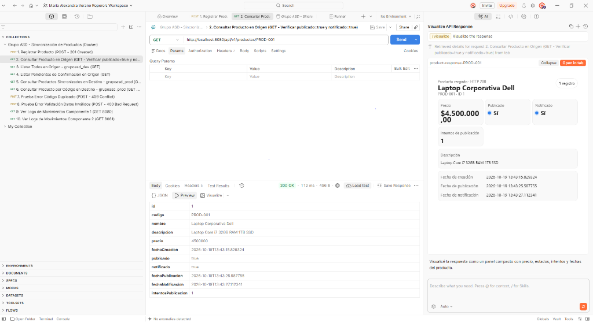

---

#### Evidencia 2 (Postman): Verificación de 0 productos pendientes de confirmación (`GET /api/v1/productos/pendientes-publicacion`)
Al consultar el endpoint de productos pendientes de confirmación en destino (`notificado = false`), devuelve una lista vacía `[]`, comprobando que el 100% de los productos registrados ya fueron publicados y confirmados por `grupoasd_prod`:

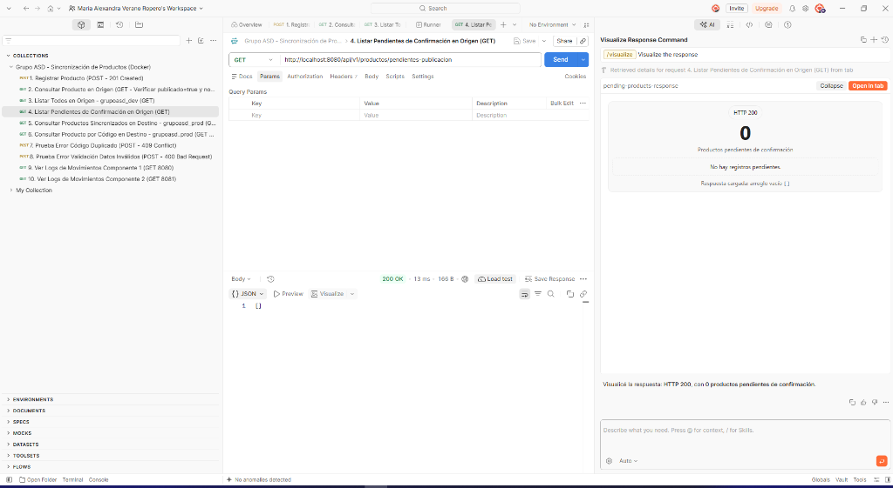

---

#### Evidencia 3 (Postman - Componente 2): Producto consumido desde ActiveMQ y sincronizado en `grupoasd_prod` (`GET :8081/api/v1/productos-destino`)
Consultando directamente el **Componente 2 (puerto 8081)**, se comprueba que el mensaje fue consumido automáticamente desde ActiveMQ y almacenado en `grupoasd_prod.producto` con `id: 1`, `idOrigen: 1` y su `fechaSincronizacion`:

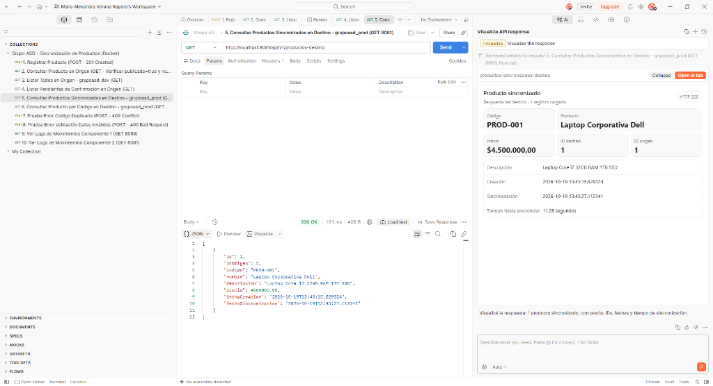

---

#### Evidencia 4 (Postman): Rechazo de código de producto duplicado (`409 Conflict`)
Al intentar registrar por segunda vez el producto con código `PROD-001`, el servicio rechaza la petición devolviendo HTTP **`409 Conflict`** (*"Ya existe un producto registrado con el código 'PROD-001'"*) y evitando registros duplicados:

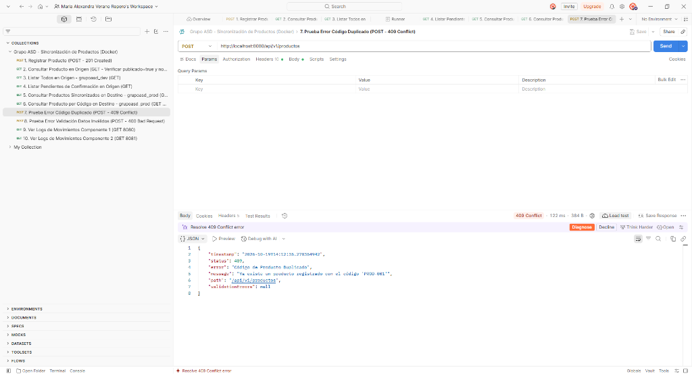

---

#### Evidencia 5 (Postman): Rechazo de petición con datos inválidos (`400 Bad Request`)
Al enviar un producto con código vacío, nombre/descripción demasiado cortos y precio negativo (`-500`), el `GlobalExceptionHandler` retorna HTTP **`400 Bad Request`** detallando las validaciones incumplidas por cada campo:

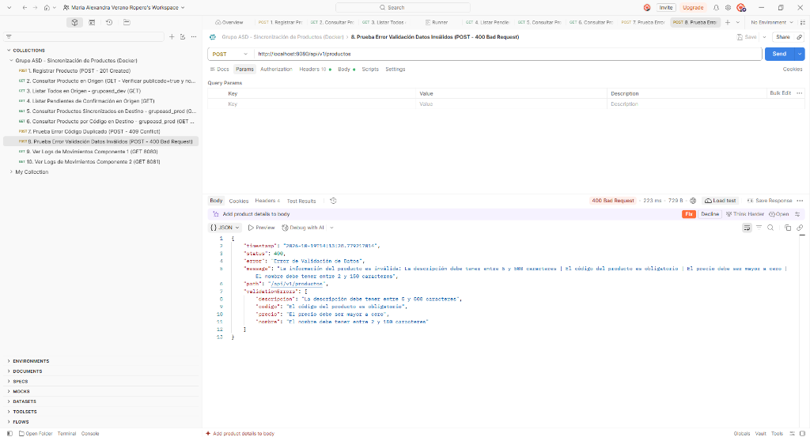

---

#### Evidencia 6 (Postman): Bitácora de Logs con Fecha y Hora en el Componente 1 (`GET :8080/api/v1/productos/logs-movimientos`)
Se evidencia el registro en el log del Componente 1 con fecha y hora exacta (`yyyy-MM-dd HH:mm:ss`), incluyendo la configuración de periodicidad del Job (`cada 10000 ms`), el alta del producto `PROD-001` y el inicio del ciclo de publicación:

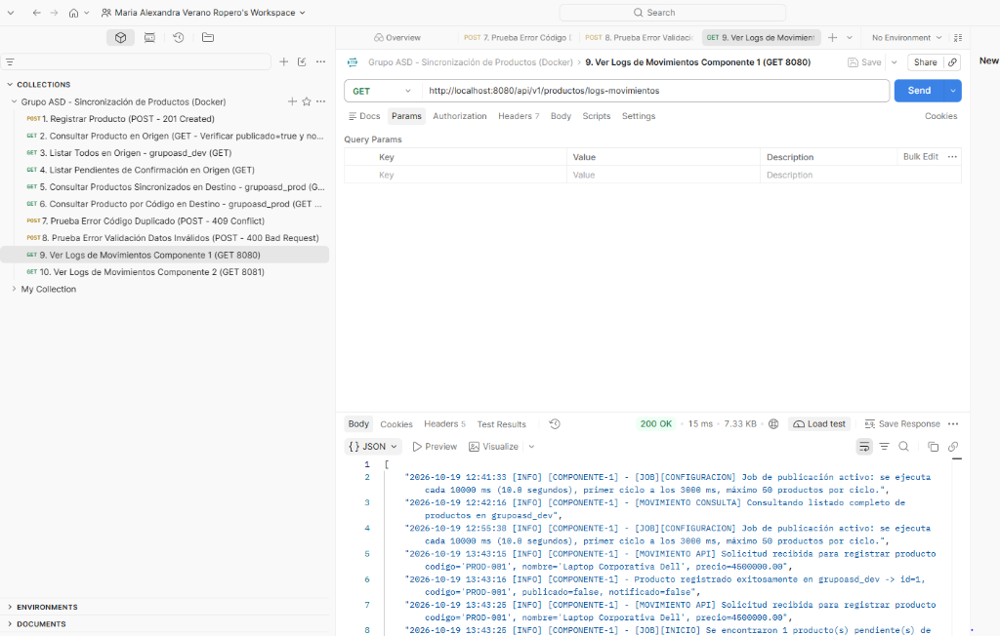

---

#### Evidencia 7 (Postman): Bitácora de Logs con Fecha y Hora en el Componente 2 (`GET :8081/api/v1/productos-destino/logs-movimientos`)
Se evidencia en el log del Componente 2 la recepción del mensaje desde ActiveMQ (`[MENSAJE RECIBIDO]`), la persistencia exitosa en `grupoasd_prod.producto` (`[RESULTADO: PERSISTIDO OK]`), el envío de la notificación a la cola de retorno y el ACK en ActiveMQ (`[PROCESAMIENTO EXITOSO - ACK]`):

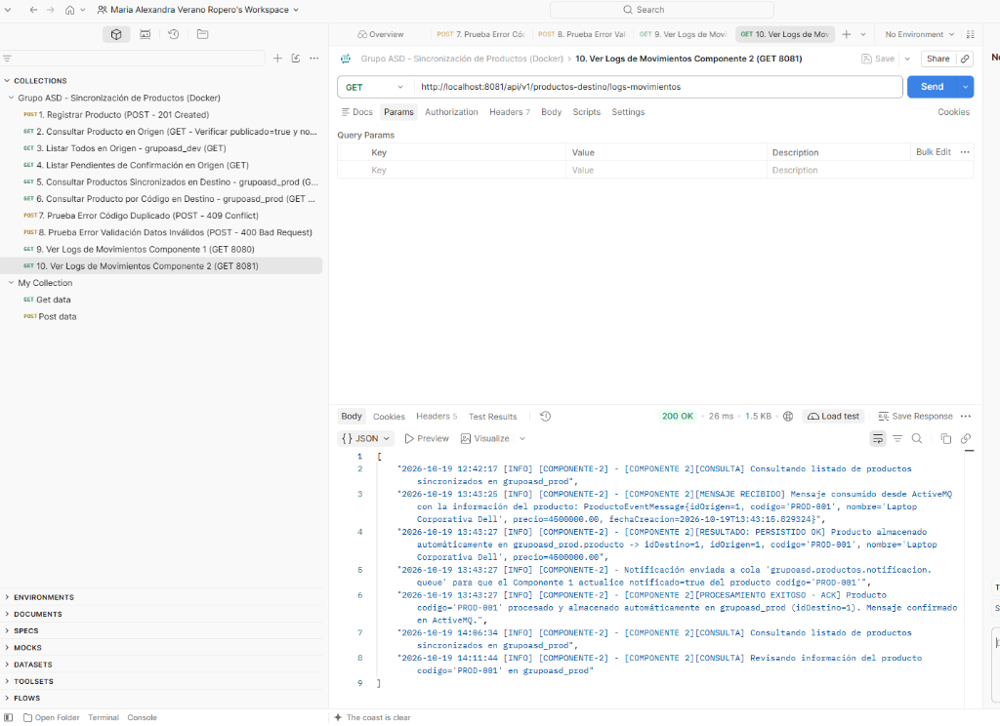

---

#### Evidencia 8 (pgAdmin 4 + PostgreSQL en Docker): Esquema Origen `grupoasd_dev.producto` (`publicado = true` y `notificado = true`)
Conectado desde **pgAdmin 4** al contenedor PostgreSQL de Docker (`Docker Grupo ASD` - base de datos `grupoasd_db`), se observan en el explorador izquierdo ambos esquemas (`grupoasd_dev` y `grupoasd_prod`) y el resultado de `SELECT * FROM grupoasd_dev.producto;` con `publicado = true`, `notificado = true`, `intentos_publicacion = 1` y sus respectivas marcas de tiempo:

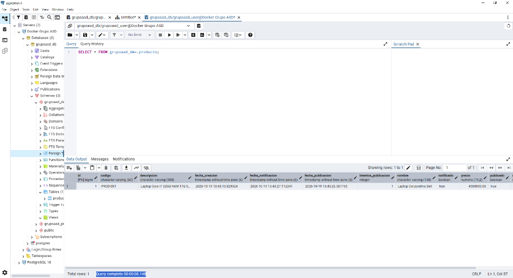

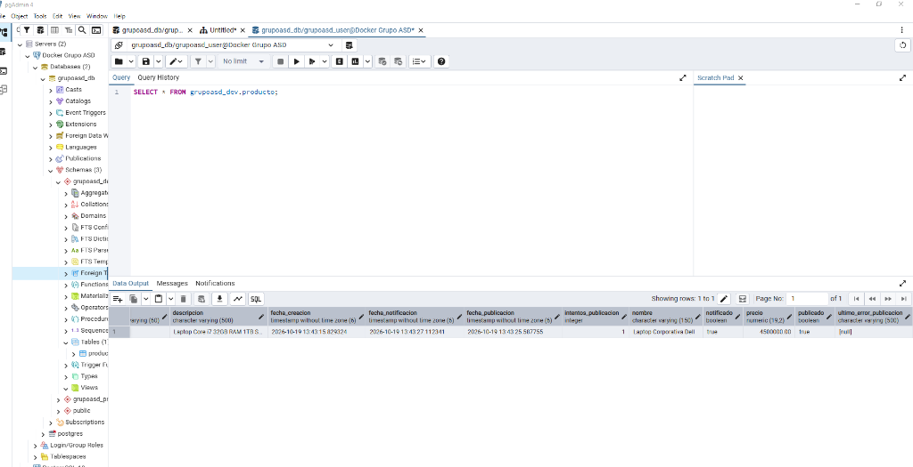

---

#### Evidencia 9 (pgAdmin 4 + PostgreSQL en Docker): Esquema Destino `grupoasd_prod.producto` (Producto Sincronizado)
Ejecutando `SELECT * FROM grupoasd_prod.producto;` en **pgAdmin 4**, se comprueba que el producto `PROD-001` (*Laptop Corporativa Dell*) quedó almacenado automáticamente en el esquema de destino `grupoasd_prod` con `id = 1`, `id_origen = 1`, `precio = 4500000.00` y `fecha_sincronizacion`:

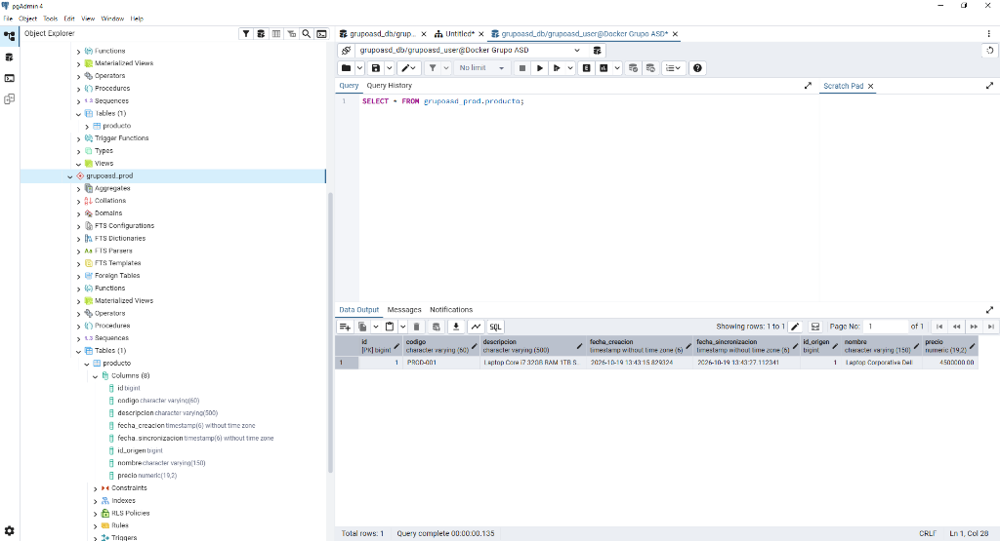

---

#### Evidencia 10 (Consola Web ActiveMQ - Puerto 8161): Colas de Registro y Confirmación (`Enqueued: 1` / `Dequeued: 1`)
En la consola administrativa de **ActiveMQ** (`http://localhost:8161/admin/queues.jsp`) se evidencian ambas colas activas (`grupoasd.productos.registro.queue` y `grupoasd.productos.notificacion.queue`), cada una con 1 consumidor conectado, 1 mensaje encolado (`Messages Enqueued: 1`), 1 mensaje procesado (`Messages Dequeued: 1`) y 0 mensajes represados:

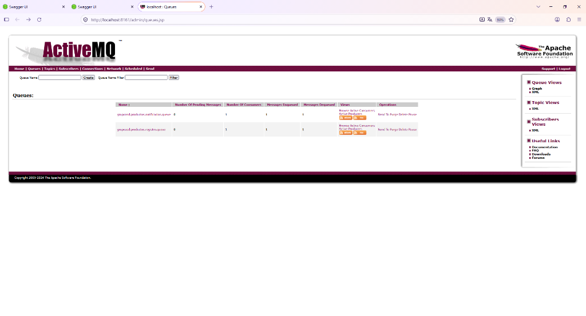

---

#### Evidencia 11 (Postman - Escenario de Caída Temporal y Auto-Recuperación): Producto `PROD-002` con `publicado: true` y `notificado: false` mientras el Componente 2 estaba detenido
Al detener temporalmente el contenedor del Componente 2 (`grupoasd-consumer-service`) y registrar el producto `PROD-002` (`201 Created` con `publicado: false, notificado: false`), el Job lo publica en ActiveMQ y en `GET /api/v1/productos/pendientes-publicacion` se observa con **`publicado: true`** y **`notificado: false`** hasta que el Componente 2 vuelve a estar en línea y confirma su persistencia:

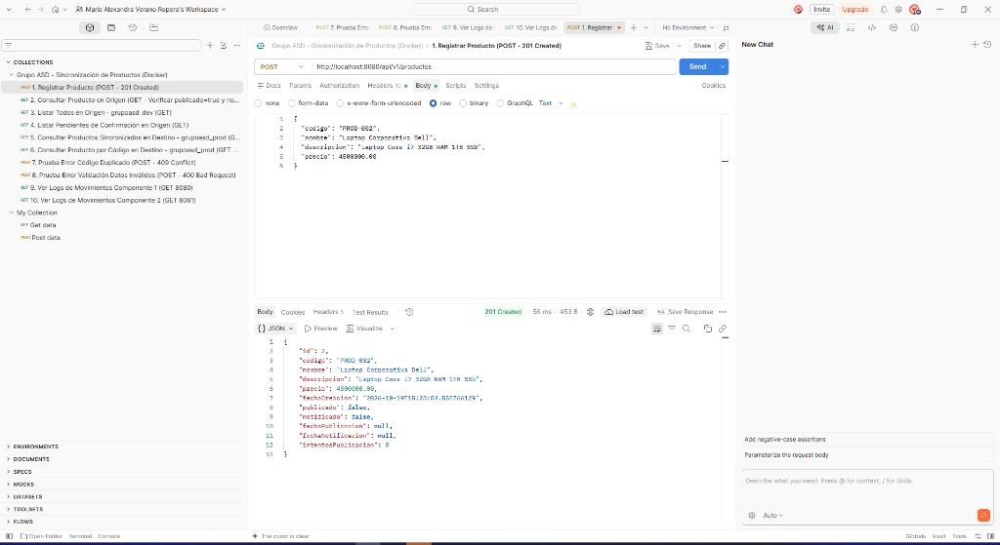

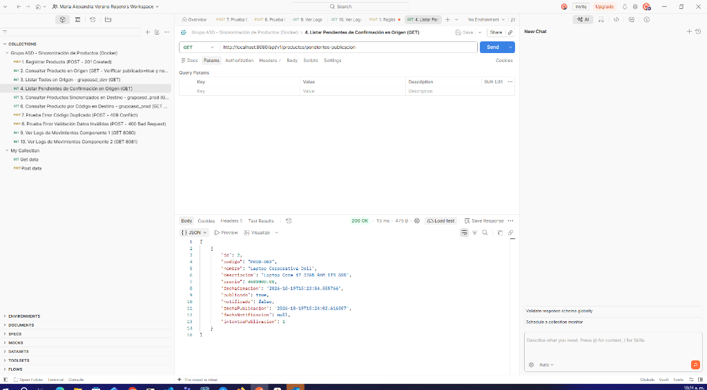

---

#### Evidencia 12 (Consola Web ActiveMQ - Dead Letter Queue `ActiveMQ.DLQ`): Manejo de Mensajes Inválidos y Fallos Reiterados
Tras recibir un mensaje con datos inválidos en la cola de registro, el Componente 2 rechazó la persistencia y aplicó la política de reintentos (`maximumRedeliveries = 3` con backoff exponencial). Al agotarse los reintentos, ActiveMQ redirigió automáticamente el mensaje inválido hacia la cola **`ActiveMQ.DLQ` (`Number Of Pending Messages: 1`)**, mientras que los mensajes válidos de `PROD-001` y `PROD-002` fueron procesados en su totalidad (`Pending: 0`):

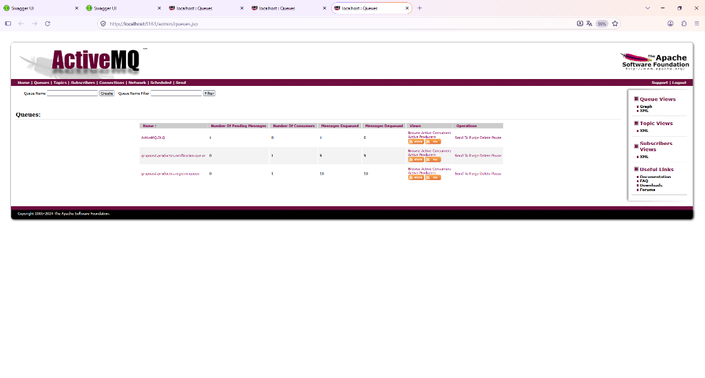

---

## 10. Resumen de Entregables y Conclusiones

| Entregable Solicitado | Ubicación en el Repositorio | Estado |
| :--- | :--- | :---: |
| **Código fuente de ambas aplicaciones** | [`product-publisher-service`](../product-publisher-service) y [`product-consumer-service`](../product-consumer-service) | ✅ Entregado |
| **Configuración para ejecutar componentes** | [`docker-compose.yml`](../docker-compose.yml) y `application.yml` en cada módulo | ✅ Entregado |
| **Archivo README con instrucciones de instalación, configuración y ejecución** | [`README.md`](../README.md) | ✅ Entregado |
| **Diagrama de arquitectura y flujo de mensajes** | Sección 2 de este documento y en `README.md` | ✅ Entregado |
| **Evidencias de las pruebas realizadas** | Sección 9 de este documento y capturas en [`docs/evidencias/`](evidencias) | ✅ Entregado |
| **Explicación del mecanismo de pendientes, prevención de duplicados y errores** | Sección 6 de este documento y en `README.md` | ✅ Entregado |
| **Despliegue completo mediante Docker Compose** | Contenedores PostgreSQL, ActiveMQ, Publisher y Consumer | ✅ Entregado |
| **Documento formal en PDF** | [`DOCUMENTACION_SOLUCION.pdf`](../DOCUMENTACION_SOLUCION.pdf) | ✅ Entregado |

La solución se encuentra completamente operativa, verificada mediante pruebas unitarias e integrales y lista para su sustentación.
