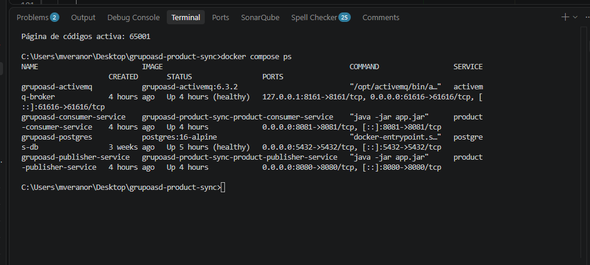
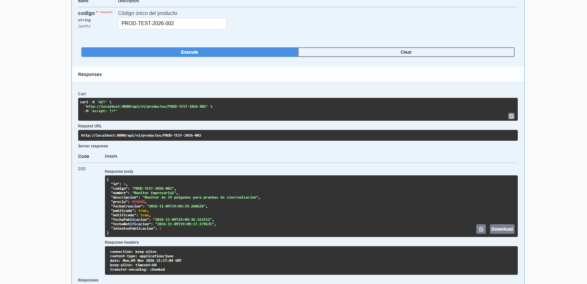
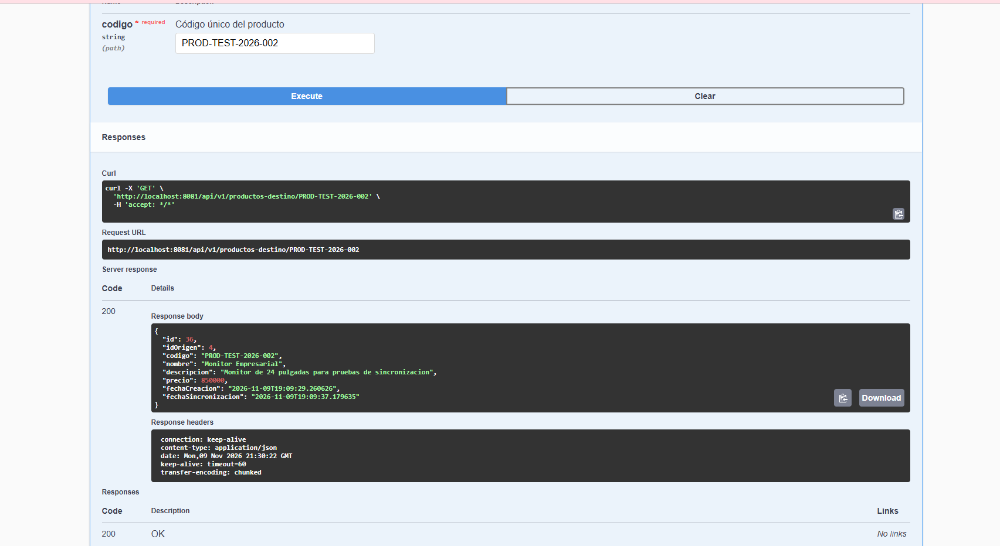
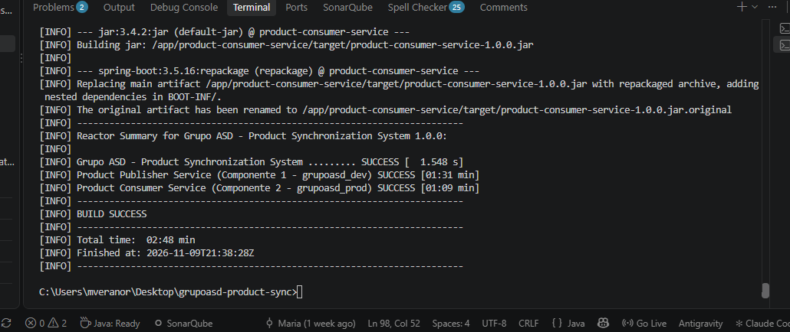
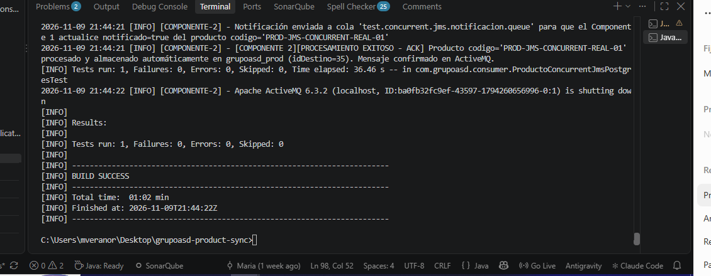

# Validación técnica complementaria — 9 de noviembre de 2026

**Proyecto:** `grupoasd-product-sync`  
**Rama evaluada:** `fix/confirmaciones-y-consistencia-jms`  
**Entorno:** Windows CMD, Docker Desktop, Maven 3.10.0 con Eclipse Temurin Java 25, PostgreSQL 16, ActiveMQ Classic 6.3.2.

> **Origen de estas evidencias:** salidas de consola y respuestas Swagger suministradas por la desarrolladora durante la revisión. Este archivo registra lo observado; no sustituye las capturas originales ni atribuye pruebas no ejecutadas.

## 1. Estado de los servicios Docker Compose

`docker compose ps` informó:

| Servicio | Estado observado | Puerto |
| --- | --- | --- |
| `grupoasd-postgres` | `Up (healthy)` | `5432` |
| `grupoasd-activemq` | `Up (healthy)` | `61616` y consola `8161` |
| `grupoasd-publisher-service` | `Up` | `8080` |
| `grupoasd-consumer-service` | `Up` | `8081` |

Las imágenes de los tres componentes construidos por el proyecto terminaron con `Built`.

## 2. Flujo real de sincronización de producto

### 2.1. Registro y manejo de código duplicado

Una petición `POST /api/v1/productos` con código `PROD-TEST-2026-002` recibió `409 Conflict`: `Código de Producto Duplicado`. Este resultado confirma rechazo del registro repetido; no equivale a haber ejecutado una nueva creación exitosa en esa petición.

### 2.2. Estado en origen (`grupoasd_dev`)

`GET http://localhost:8080/api/v1/productos/PROD-TEST-2026-002` respondió HTTP `200`:

```json
{
  "id": 4,
  "codigo": "PROD-TEST-2026-002",
  "nombre": "Monitor Empresarial",
  "descripcion": "Monitor de 24 pulgadas para pruebas de sincronizacion",
  "precio": 850000,
  "fechaCreacion": "2026-11-09T19:09:29.260626",
  "publicado": true,
  "notificado": true,
  "fechaPublicacion": "2026-11-09T19:09:36.162152",
  "fechaNotificacion": "2026-11-09T19:09:37.179635",
  "intentosPublicacion": 1
}
```

### 2.3. Estado en destino (`grupoasd_prod`)

`GET http://localhost:8081/api/v1/productos-destino/PROD-TEST-2026-002` respondió HTTP `200`:

```json
{
  "id": 36,
  "idOrigen": 4,
  "codigo": "PROD-TEST-2026-002",
  "nombre": "Monitor Empresarial",
  "descripcion": "Monitor de 24 pulgadas para pruebas de sincronizacion",
  "precio": 850000,
  "fechaCreacion": "2026-11-09T19:09:29.260626",
  "fechaSincronizacion": "2026-11-09T19:09:37.179635"
}
```

Los ID locales pueden diferir: la correspondencia se realiza por `idOrigen=4` y el código del producto.

## 3. Pruebas Maven: suite habitual

Comando ejecutado desde la raíz del proyecto en CMD:

```cmd
docker run --rm -v "%cd%:/app" -w /app maven:3.10.0-eclipse-temurin-25-alpine mvn clean verify
```

Resumen reportado:

```text
Tests run: 13, Failures: 0, Errors: 0, Skipped: 1
Grupo ASD - Product Synchronization System ......... SUCCESS
Product Publisher Service .......................... SUCCESS
Product Consumer Service ........................... SUCCESS
BUILD SUCCESS
Total time: 02:39 min
Finished at: 2026-11-09T20:07:11Z
```

Los 13 tests corresponden al resumen visible del consumidor, no al total del repositorio. La prueba concurrente PostgreSQL se omite en la suite general por no incluir `CONCURRENCY_TEST_DB_URL`. La prueba JMS especial se añadió posteriormente y se ejecutó por separado.

## 4. Concurrencia transaccional contra PostgreSQL real

Comando:

```cmd
docker run --rm -e CONCURRENCY_TEST_DB_URL=jdbc:postgresql://host.docker.internal:5432/grupoasd_test_db?currentSchema=grupoasd_prod -v "%cd%:/app" -w /app maven:3.10.0-eclipse-temurin-25-alpine mvn -pl product-consumer-service -Dtest=ProductoConcurrencyPostgresTest test
```

Resultado comunicado:

```text
Producto guardado con idDestino=31 y código PROD-CONCURRENT-REAL-01
SQLState: 23505
duplicate key value violates unique constraint "producto_codigo_key"
[RESULTADO: DUPLICADO OMITIDO] idDestino=31
Tests run: 1, Failures: 0, Errors: 0, Skipped: 0
BUILD SUCCESS
Finished at: 2026-11-09T20:02:36Z
```

La prueba comprueba que PostgreSQL aplica la unicidad, la transacción perdedora falla y una **nueva transacción** encuentra el producto existente. En esta prueba, la repetición se invoca desde código de test; no es evidencia por sí sola de reentrega JMS.

## 5. Reentrega JMS con dos consumidores y PostgreSQL real

Prueba: `ProductoConcurrentJmsPostgresTest`.

Comando:

```cmd
docker run --rm -e CONCURRENCY_TEST_DB_URL=jdbc:postgresql://host.docker.internal:5432/grupoasd_test_db?currentSchema=grupoasd_prod -v "%cd%:/app" -w /app maven:3.10.0-eclipse-temurin-25-alpine mvn -pl product-consumer-service -Dtest=ProductoConcurrentJmsPostgresTest test
```

- Base de datos: `grupoasd_test_db`, esquema `grupoasd_prod`.
- Broker JMS: ActiveMQ integrado de pruebas (`vm://localhost`), no el broker Docker de la aplicación.
- Cola: `test.concurrent.jms.registro.queue` y cola de confirmación `test.concurrent.jms.notificacion.queue`.
- Dos consumidores: `app.messaging.listener.concurrency=2-2`, `queue-prefetch=1`.
- Dos envíos idénticos: `PROD-JMS-CONCURRENT-REAL-01`.
- Aserciones: ambos consumidores leen inicialmente el producto como ausente; llegan dos confirmaciones con el mismo `idDestino`; la consulta SQL registra exactamente una fila; se exige al menos una consulta adicional, consistente con reentrega.

**Resultado aportado:** `BUILD SUCCESS`, duración `58.343 s`, finalizado `2026-11-09T20:20:15Z`. No se compartió el conteo individual `Tests run`; guardar el informe Surefire de esta clase para el paquete final.

## 6. Correcciones realizadas

- Dockerfiles: referencia válida de imagen Maven y descarga de distribución de ActiveMQ.
- Confirmaciones de productos: verificación de identidad `codigo` y `idOrigen`, y protección contra respuestas negativas tardías.
- Confirmación JMS posterior a commit de PostgreSQL usando `TransactionSynchronization.afterCommit()`.
- Colisión por unicidad: propagar error para rollback completo y permitir reintento JMS, sin consultar PostgreSQL dentro de una transacción abortada.
- Configuración del número de consumidores JMS y prefetch mediante propiedades, manteniendo como valor predeterminado un consumidor.
- Pruebas unitarias de regresión, concurrencia de dos transacciones y reentrega con dos consumidores JMS.

## 7. Riesgo residual y límites de alcance

- `afterCommit()` asegura el orden lógico de confirmación, pero no persistencia duradera de la intención de enviar el mensaje si el proceso se detiene justo después del commit. Sin outbox transaccional o mecanismo equivalente, queda una ventana de pérdida de confirmación.
- Los resultados `BUILD SUCCESS` demuestran que las aserciones ejecutadas pasaron, no que el sistema sea infalible.
- No se registró una prueba de caída abrupta en el intervalo commit-notificación.
- El PR permanece en borrador y sin integrar a `main`; no presentar las correcciones como parte de `main` hasta su revisión y merge.
- El README y esta evidencia describen las modificaciones de noviembre. Los archivos Word/PDF existentes pueden contener explicaciones anteriores y requieren regeneración o nota de versión.

## 8. Evidencias a adjuntar a la entrega

1. Captura `docker compose ps` con los cuatro servicios en estado `Up`.
2. Capturas Swagger: GET origen `publicado=true`, `notificado=true`; GET destino `idOrigen=4`.
3. Consola de `mvn clean verify` mostrando los tres módulos `SUCCESS`.
4. Consola de `ProductoConcurrencyPostgresTest` con `Tests run: 1` y `BUILD SUCCESS`.
5. Consola o `target/surefire-reports` de `ProductoConcurrentJmsPostgresTest` para acreditar la ejecución.
6. Diagramas existentes de arquitectura y flujo de mensajes.
7. Revisión del PR y confirmación de la rama que se entregará.


## 9. Capturas visuales incorporadas

Las siguientes imágenes fueron incorporadas al repositorio en la rama de correcciones. Se referencian desde este informe para facilitar la revisión de las evidencias junto con su explicación.

### Evidencia 1. Servicios Docker Compose



Muestra el resultado de `docker compose ps` y el estado del entorno.

### Evidencia 2. Publicador: origen y confirmación



Permite revisar el producto por código, con `publicado=true` y `notificado=true`.

### Evidencia 3. Consumidor: persistencia en destino



Permite verificar la persistencia y la referencia `idOrigen`.

### Evidencia 4. Suite general Maven



Muestra el resultado de la verificación automatizada de los módulos.

### Evidencia 5. Concurrencia JMS



Muestra el resultado de la prueba de dos consumidores JMS y el broker de pruebas.
